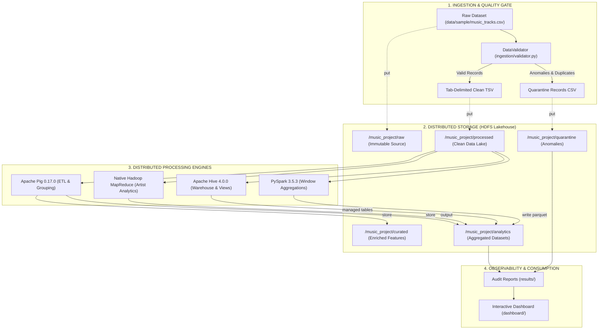

# Architecture Specification: Music Track & Popularity Analytics Platform

## 1. High-Level Architecture Overview

The Music Track & Popularity Analytics Platform is an enterprise-grade Big Data pipeline designed to ingest, clean, store, enrich, and analyze music metadata across distributed processing engines running on Hadoop HDFS.

---

## 2. Component Responsibilities

| Component | Technology | Primary Responsibility |
| :--- | :--- | :--- |
| **Ingestion Engine** | Python 3 | Schema conformance check, boundary validation, deterministic deduplication, audit metric generation. |
| **Storage Layer** | Hadoop HDFS 3.5.0 | Five-layer distributed data lake (`raw`, `processed`, `curated`, `analytics`, `quarantine`). |
| **ETL Engine** | Apache Pig 0.17.0 | High-level data transformation, feature enrichment (`duration_sec`, `popularity_tier`), and genre grouping. |
| **Batch Analytics** | Native Java MapReduce | Heavy parallel artist aggregation across millions of records with custom Map/Reduce jobs. |
| **Data Warehouse** | Apache Hive 4.0.0 | Structured external tables over HDFS, analytical views, and managed ORC data store. |
| **Analytical Engine** | PySpark 3.5.3 | Distributed DataFrame operations, window functions for top track rankings, and Snappy Parquet generation. |
| **Observability** | Python & JSON | Centralized pipeline logging, runtime execution metrics, and data-quality reports. |
| **Visualization** | Vanilla HTML/CSS/JS + Chart.js | Real-time dashboard displaying authentic pipeline metrics and analytical findings. |

---

## 3. Storage Layering Contract (Data Lake Architecture)

1. **`raw/` (Immutable Source)**: Stores the untouched original dataset exactly as delivered from upstream sources. No transformation or deletion is permitted in this layer.
2. **`processed/` (Clean Lake)**: Contains records that successfully passed validation and deduplication, structured as tab-delimited text for uniform consumption across all engines.
3. **`curated/` (Enriched Features)**: Business-ready datasets output by Pig ETL with derived features (e.g. `duration_sec`, `popularity_tier`).
4. **`analytics/` (Aggregated Outputs)**: Highly optimized summary datasets stored as TSV, ORC, and Parquet.
5. **`quarantine/` (Rejected Records)**: Malformed or schema-violating rows serialized with unique IDs, error codes, and audit timestamps.

---

## 4. Local Deployment vs. Production Scalability

- **Local Development Environment**: Deployed in pseudo-distributed mode on a single Fedora workstation utilizing local HDFS daemons (`hdfs://localhost:9000`), local YARN resource manager, and Derby-backed Hive metastore.
- **Production Scaling Path**:
  - Migrate NameNode/ResourceManager to High Availability (HA) multi-node active/standby topologies with ZooKeeper Failover Controllers (ZKFC).
  - Transition metastore from embedded Derby to PostgreSQL or MySQL with connection pooling.
  - Scale DataNodes across independent rack-aware worker nodes.
  - Deploy Spark jobs across dedicated YARN node clusters.
